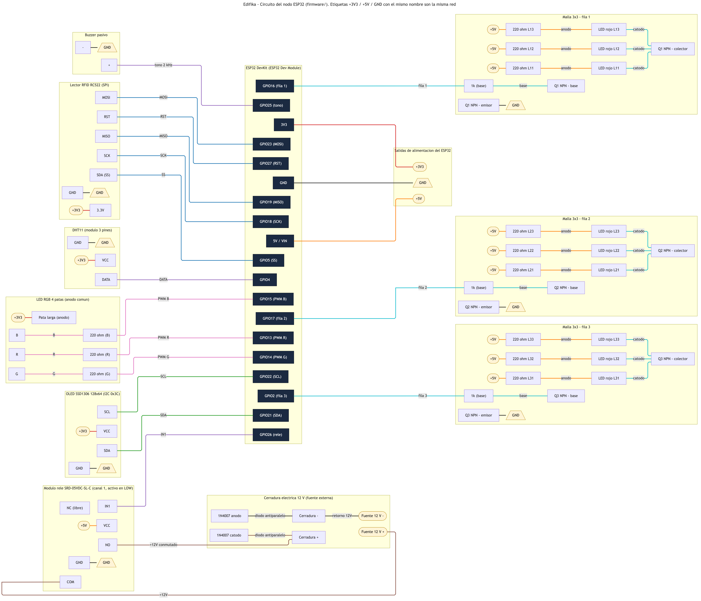

# firmware — nodo ESP32 de Edifika

Firmware del nodo IoT de Edifika construido sobre el nano-framework **ModestIoT**. Reemplaza al sketch
`edifika_test.ino` (repo `edifika-report`, en `wokwi/firmware/edifika_test/`) con el mismo comportamiento, pero
cada sensor y actuador se modela como `Sensor` / `Actuator` de ModestIoT y la orquestación vive en un `Device`.

## Estructura

```
firmware/
├── firmware.ino                 # setup(): construye EdifikaNode y arranca el motor asíncrono
└── src/
    ├── ModestIoT/               # Framework copiado sin modificaciones
    ├── config/NodeConfig.h      # Pines y parámetros (umbrales, tiempos, polaridades, red)
    ├── config/Secrets.example.h # Plantilla de Wi-Fi y broker; copiar como Secrets.h (ignorado por git)
    ├── connectivity/WiFiStationDriver.*   # Wi-Fi          -> WiFiConnectivityDriver
    ├── gateway/EdgeMqttGatewayClient.*    # MQTT con Edge  -> GatewayClient
    ├── telemetry/NodeMessages.*           # Mensajes JSON  -> TelemetryPackage
    ├── sensors/RfidReader.*     # RC522            -> Sensor
    ├── actuators/Relay.*        # Relé cerradura   -> Actuator
    ├── actuators/RgbLed.*       # LED RGB (PWM)    -> Actuator
    ├── actuators/OledDisplay.*  # OLED SSD1306     -> Actuator
    └── devices/EdifikaNode.*    # Device: eventos de sensores -> comandos a actuadores
```

## Mapeo de componentes

| Componente | Clase | Origen |
|---|---|---|
| DHT11 (GPIO4) | `DhtSensor` | ModestIoT |
| Buzzer (GPIO25) | `Buzzer` | ModestIoT |
| Filas de la malla 3x3 (GPIO16, 17, 2) | `Led` ×3 | ModestIoT |
| Lector RFID RC522 (SPI, SS 5, RST 27) | `RfidReader : Sensor` | nuevo, sobre la clase abstracta |
| Relé de la cerradura (GPIO26, activo en bajo) | `Relay : Actuator` | nuevo, sobre la clase abstracta |
| LED RGB (GPIO13, 14, 15, ánodo común) | `RgbLed : Actuator` | nuevo, sobre la clase abstracta |
| OLED SSD1306 (I2C 0x3C) | `OledDisplay : Actuator` | nuevo, mismo patrón que `CharacterLcdDisplay` |
| Nodo completo | `EdifikaNode : Device` | nuevo |

ModestIoT no trae RFID, relé con polaridad invertida, RGB por PWM ni pantallas gráficas, así que esas
cuatro clases extienden `Sensor` / `Actuator` siguiendo las convenciones del framework: identificadores
`*_IDENTIFIER` con su `Command`/`Event` precreado, parámetros guardados con un setter antes del comando
(como `Buzzer::setTone`), supresión de propagación con identificador `-1` y la dirección I2C o el pin
principal guardados en `pin`.

## Cómo funciona

`Device` dispara un timer cada 10 ms y atiende en round-robin tres slots del planificador:

1. `RfidReader` ← `MEASURE_DATA_REQUESTED_EVENT` → emite `CARD_DETECTED_EVENT` (60)
2. `EdifikaNode` ← `DEVICE_TICK_EVENT` (90): el propio nodo se registra como `EventHandler` para correr
   lo que depende del tiempo (cerrar la cerradura a los 3 s, degradado RGB, filas de la malla, refresco de la OLED)
3. `DhtSensor` ← `MEASURE_DATA_REQUESTED_EVENT` → emite `DATA_READ_EVENT` (20) cuando cambia la lectura

Al leer una tarjeta, el nodo pita, ejecuta `UNLOCK_DOOR_COMMAND` (400), que también puede llegar desde
afuera más adelante, y muestra la tarjeta 3 s en la OLED. El `loop()` se elimina: todo corre en las tareas
FreeRTOS de `Device`.

## Conexión a internet (Wi-Fi + MQTT)

El nodo se conecta por Wi-Fi al broker MQTT (Mosquitto) del Edge Gateway y sigue el contrato v1 del informe:

| Sentido | Tópico | Cuándo |
|---|---|---|
| Nodo → Edge | `edifika/v1/nodes/{deviceId}/heartbeat` | Al conectar con el broker y luego cada 30 s |
| Nodo → Edge | `edifika/v1/nodes/{deviceId}/access` | Cada tarjeta leída (`credentialType: RFID`, UID compacto) |
| Nodo → Edge | `edifika/v1/nodes/{deviceId}/readings` | Cuando cambia el DHT11 (`temperature` en C y `humidity` en %) |
| Nodo → Edge | `edifika/v1/nodes/{deviceId}/ack` | Respuesta a cada comando (`OK` / `ERROR`) |
| Edge → Nodo | `edifika/v1/nodes/{deviceId}/commands` | `type: "unlock"` con `params.duration_ms` opcional |

Todos los mensajes llevan `"v":"1"` y `ts` en ISO-8601 UTC sincronizado por NTP; mientras el reloj no está
sincronizado se envía `ts: null` en vez de una hora inventada.

Qué se usa de ModestIoT y qué se extendió:

- `WiFiConnectivityDriver` deja `transmit()` sin implementar (la clase es abstracta), así que
  `WiFiStationDriver` lo hereda tal cual y solo completa `transmit()` (envío TCP puntual a `"host:port"`).
- `MqttGatewayClient` publica en un único tópico fijo y no se suscribe, así que `EdgeMqttGatewayClient`
  extiende `GatewayClient` para publicar cada mensaje en su canal y recibir `/commands`.
- Los mensajes son `TelemetryPackage` y viajan por la cola de telemetría de `Device`: se encolan en la tarea
  de hardware y se publican en `processQueuedTelemetryData()` (tarea NetworkWorker).
- `loop()` mantiene la sesión (`maintainNetwork()`, reintento cada 5 s). Los comandos recibidos pasan por una
  cola FreeRTOS y se ejecutan en el tick del nodo, así los actuadores solo se tocan desde una tarea.

Configuración:

1. `cp src/config/Secrets.example.h src/config/Secrets.h` y completar SSID, contraseña e IP del broker.
2. En `NodeConfig.h`: `DEVICE_ID`, y `UNLOCK_ON_ANY_CARD`. Con `true` (modo prueba) cualquier tarjeta abre;
   con `false` la cerradura solo abre cuando el Edge valida la tarjeta y responde `unlock`.

### Broker local (Mosquitto en Docker)

`broker/` levanta la imagen oficial `eclipse-mosquitto:2` en el puerto 1883, sin usuarios ni TLS (solo para la
red de desarrollo). En `Secrets.h`, `MQTT_BROKER_HOST` debe ser la IP de la máquina que corre Docker.

```bash
cd broker && docker compose up -d     # levantar
docker logs -f edifika-mqtt-logger    # datos del nodo (tambien en Docker Desktop, contenedor edifika-mqtt-logger)
./broker/watch.sh                     # lo mismo, en una terminal interactiva
./broker/watch.sh readings            # solo un canal
docker logs -f edifika-mosquitto      # solo conexiones / desconexiones (Mosquitto no registra el contenido)

# mandar un comando al nodo (abre la cerradura 5 s y responde en /ack)
docker exec edifika-mosquitto mosquitto_pub -t edifika/v1/nodes/esp32-acc-01/commands \
  -m '{"v":"1","commandId":"cmd-001","type":"unlock","params":{"duration_ms":5000}}'
```

## Tests en el host

Para correr la suite de tests unitarios puros (parseo de comandos, máquina de estados de puerta) sin depender del hardware ni de Arduino:

`ash
bash test/run_tests.sh
`

Requiere g++ (C++17) y ash en el PATH.

## Compilar

Placa **ESP32 Dev Module**, core **esp32 3.x** (ModestIoT usa la API de timers de 3.x).

Librerías: `ArduinoJson`, `PubSubClient`, `DHT sensor library`, `Adafruit Unified Sensor`, `Adafruit SSD1306`, `Adafruit GFX Library`,
`MFRC522`. Como el IDE compila todo `src/`, ModestIoT completo también pide `LiquidCrystal I2C`, `ESP32Servo`
y `HX711`, aunque este nodo no los use.

```bash
arduino-cli lib install ArduinoJson "DHT sensor library" "Adafruit Unified Sensor" "Adafruit SSD1306" \
  "Adafruit GFX Library" MFRC522 "LiquidCrystal I2C" ESP32Servo HX711 PubSubClient
arduino-cli compile -b esp32:esp32:esp32 .
arduino-cli upload  -b esp32:esp32:esp32 -p <puerto> .
```

En Arduino IDE basta con abrir `firmware.ino` (después de crear `src/config/Secrets.h`). Con Wi-Fi el binario
ocupa ~76 % de la partición por defecto; si crece, elegir el esquema de partición *Huge APP*.

## Diferencias con `edifika_test.ino`

- `DhtSensor` descarta las lecturas fallidas o repetidas: la OLED conserva el último valor válido en vez de
  mostrar `--.-` tras un error, y `T=… H=…` solo se imprime cuando la lectura cambia.
- El degradado RGB se calcula a partir de `millis()` (mismo recorrido de ~5 s por tramo) porque el tick
  del nodo llega cada 30 ms, no cada 10 ms.

## Diagrama del circuito



`docs/circuito.mmd` (Mermaid) se genera con `docs/gen_circuit.py`: un nodo por pin y una línea por cable,
coloreada por tipo de señal. Las etiquetas `+3V3`, `+5V` y `GND` repetidas son la misma red. Para regenerarlo:

```bash
python3 docs/gen_circuit.py docs/circuito.mmd
npx -y @mermaid-js/mermaid-cli@11.4.2 -i docs/circuito.mmd -o docs/circuito.png -w 4000 -s 2 -b white
```
